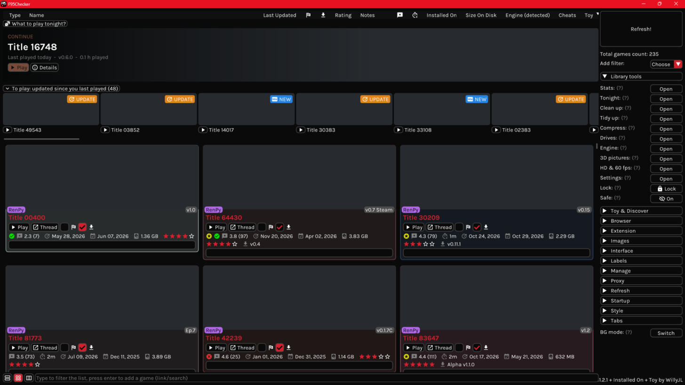

# F95Checker Enhanced

**[English](README.md)** · **[Guide d'utilisation](docs/GUIDE_UTILISATEUR.md)** · **[Notes de version](docs/PATCH_NOTES.fr.md)** · **[Licences tierces](THIRD_PARTY_NOTICES.md)** · **[☕ Ko-fi](https://ko-fi.com/alex200295)**

Une version modifiée de **[F95Checker](https://github.com/WillyJL/F95Checker) de WillyJL** (version 11.2.1) qui en fait un
vrai gestionnaire des jeux **installés sur ton PC** : il les retrouve sur tes disques, te dit lesquels ont vraiment besoin
d'une mise à jour, installe les mises à jour et les mods, et ajoute des outils pour les jeux Ren'Py (triche, images HD,
animations à 60 i/s, 3D et images vivantes), la synchro d'un jouet connecté, des outils de discrétion et de ménage.

Tout ce que F95Checker fait déjà (suivi des threads, notifications, extension navigateur…) reste identique.

## Téléchargement

**[Dernière version](https://github.com/Alex200295/F95Checker_Enhanced/releases/latest)** → `F95Checker_Enhanced-Windows.zip`.

1. Décompresse-le dans son propre dossier, par exemple `C:\Programmes\F95Checker Enhanced` (pas dans
   `%APPDATA%\f95checker`, et pas dans un dossier qui contient d'autres fichiers : une mise à jour depuis l'appli remplace
   tout le dossier).
2. Lance `F95Checker.exe`.

C'est tout : **Real-ESRGAN, RIFE, ffmpeg et le modèle Depth Anything V2 Small sont inclus** dans le dossier `tools`, et
ONNX Runtime (carte graphique) dans le programme. Rien d'autre à télécharger.

**Tu utilises déjà F95Checker ?** F95Checker Enhanced utilise le même dossier de données (`%APPDATA%\f95checker`) : ta
bibliothèque, tes réglages et ta connexion sont là dès le premier lancement. Aucune nouvelle colonne en base : tu peux
revenir à la version officielle quand tu veux sans rien perdre. Ferme d'abord le F95Checker officiel, et copie
`db.sqlite3` à l'abri si tu veux une sauvegarde.

Configuration : Windows 10/11 64 bits. Une carte graphique compatible Vulkan (toute NVIDIA / AMD / Intel récente) pour
les fonctions d'IA. Les versions Linux et macOS sont aussi compilées, sans les outils inclus (les fonctions qui en ont
besoin l'indiquent).

## Ce que ça ajoute

| | |
|---|---|
| **Scan de la bibliothèque** | Exe trouvés tout seuls, **Installed** coché quand ta copie est la dernière, date **Installed On**, taille, vrai moteur, triche présente, dernière partie (lue dans les sauvegardes), anciennes versions et doublons à supprimer |
| **Mises à jour** | Liste **Updates to do** avec le changelog depuis ta version, **Download** dans ton navigateur, **Import Update** depuis l'archive (sauvegardes copiées, dossier renommé), surveillance des téléchargements |
| **Bibliothèque** | Diaporama au survol, étagère *To play*, bandeau *Continue*, bannières plus nettes, statistiques, *What to play tonight?* |
| **Ren'Py** | Console, **fiche de triche**, **menu de triche en jeu (Maj+C)**, galerie débloquée, retour arrière toujours permis, préférences communes, **What went wrong?** après un plantage, installation de mods |
| **HD & 60 fps** | Images HD pour les jeux Ren'Py 8.4+ faits pour un écran plus petit, animations à deux fois plus d'images par seconde (RIFE), annulable |
| **3D & images vivantes** | Profondeur calculée par ta carte graphique : images « vivantes » discrètes, ou 3D côte à côte pour la VR (Half SBS), **Maj+P** en jeu |
| **Jouet connecté** | Intiface Central : synchro des animations Ren'Py à partir de scripts générés depuis les animations elles-mêmes, vibrations manette, mode son, va-et-vient, motifs, arrêts de sécurité |
| **Disques** | Compression, rééquilibrage des disques, ménage, rangement, moteur Ren'Py partagé |
| **Discrétion** | Touche de discrétion, **écran sage** (Ctrl+Alt+B), verrou par code |

Liste complète : **[notes de version](docs/PATCH_NOTES.fr.md)**. Mode d'emploi de chaque fonction :
**[guide d'utilisation](docs/GUIDE_UTILISATEUR.md)**.

## Bon à savoir

- **Il modifie des fichiers dans les dossiers de tes jeux** (seulement les jeux Ren'Py, seulement de petits scripts
  `zz_f95checker_*.rpy` / `zz_f95toy.rpy`, plus ce que tu demandes : images HD, vidéos 60 i/s, cartes de profondeur,
  mods). Chaque ajout se retire (clic droit sur le jeu, ou décoche l'option dans *Library tools → Settings*), et les
  fichiers du jeu ne sont jamais écrasés sans copie de secours. Sauvegarde ta partie avant de tricher.
- La console, le menu de triche en jeu et le script de synchro du jouet sont **ajoutés à tous les jeux Ren'Py par
  défaut** à chaque *Refresh* : décoche *Cheats in Ren'Py games*, *Cheat menu in Ren'Py games* (Library tools →
  Settings) et *Toy sync on for every game* (panneau Toy) si tu n'en veux pas.
- HD & 60 fps et la 3D prennent du temps (des heures pour une grosse bibliothèque) et de la place ; plus rien n'est écrit
  sur un disque qui a moins de 15 Go libres.
- Le jouet connecté demande **[Intiface Central](https://intiface.com/central)** (gratuit) et ne fait rien tant qu'aucun
  jouet n'est connecté.

## Crédits et licence

- **F95Checker** est développé par **WillyJL** et ses contributeurs : https://github.com/WillyJL/F95Checker — soutiens
  le projet d'origine : https://linktr.ee/WillyJL. **Ne signale pas les bugs des fonctions Enhanced à WillyJL** : ouvre
  une *issue* ici.
- F95Checker Enhanced : fork par **Alex200295**, même licence, **GPLv3** (`LICENSE`).
  Les fonctions Enhanced te plaisent ? Tu peux les soutenir sur **[Ko-fi](https://ko-fi.com/alex200295)** ☕ — facultatif, rien n'est bloqué.
- Outils inclus et leurs licences : **[THIRD_PARTY_NOTICES.md](THIRD_PARTY_NOTICES.md)** (Real-ESRGAN, RIFE, FFmpeg,
  Depth Anything V2 Small, ONNX Runtime).
- Sans lien avec F95zone.
