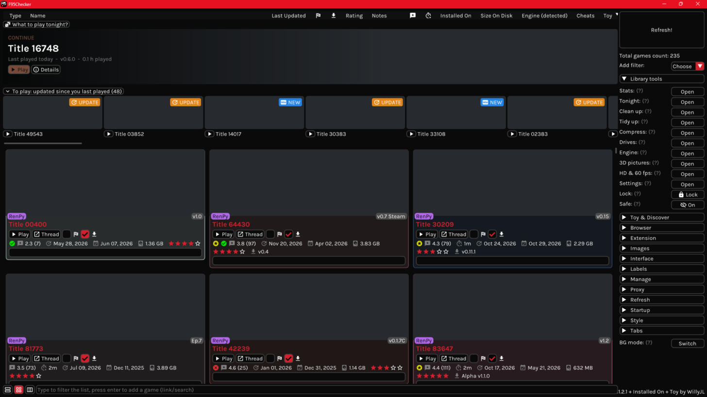

# F95Checker Enhanced

**[Français](README.fr.md)** · **[User guide](docs/USER_GUIDE.md)** · **[Patch notes](CHANGELOG.md)** · **[Third-party notices](THIRD_PARTY_NOTICES.md)** · **[☕ Ko-fi](https://ko-fi.com/alex200295)**

A fork of **[F95Checker](https://github.com/WillyJL/F95Checker) by WillyJL** (version 11.2.1) that turns it into a full
manager for the games **installed on your PC**: it finds them on your drives, tells you which ones really need an update,
installs updates and mods, and adds tools for Ren'Py games (cheats, HD pictures, 60 fps animations, 3D and living
pictures), a connected-toy sync, privacy tools and housekeeping.

Everything F95Checker already does (tracking threads, notifications, browser extension...) is unchanged.

## Download

**[Latest release](https://github.com/Alex200295/F95Checker_Enhanced/releases/latest)** → `F95Checker_Enhanced-Windows.zip`.

1. Unzip it into its own folder, for example `C:\Programs\F95Checker Enhanced` (not inside `%APPDATA%\f95checker`, and
   not in a folder with other files: an in-app update replaces the whole folder).
2. Run `F95Checker.exe`.

That's all: **Real-ESRGAN, RIFE, ffmpeg and the Depth Anything V2 Small model are included** in the `tools` folder, and
ONNX Runtime (graphics card) in the program itself. Nothing else to download.

**Already using F95Checker?** F95Checker Enhanced uses the same data folder (`%APPDATA%\f95checker`): your library,
settings and login are there at the first start. No new database column: you can go back to the official version at any
time without losing anything. Close the official F95Checker first, and copy `db.sqlite3` somewhere safe if you want a
backup.

Requirements: Windows 10/11 64-bit. A graphics card with Vulkan (any recent NVIDIA / AMD / Intel) for the AI features.
Linux and macOS builds are made too, without the bundled tools (the features that need them say so).

## What it adds

| | |
|---|---|
| **Local library scan** | Executables found by themselves, **Installed** ticked when your copy is the latest, **Installed On** date, size, real engine, cheats present, last played (from the saves), old versions and duplicates to delete |
| **Updates** | **Updates to do** list with the changelog since your version, **Download** in your browser, **Import Update** from the archive (saves backed up, folder renamed), downloads watcher |
| **Library** | Hover slideshow, To play shelf, Continue banner, sharper banners, statistics, What to play tonight? |
| **Ren'Py** | Console, **cheat sheet**, **in-game cheat menu (Shift+C)**, gallery unlock, rollback always allowed, shared preferences, **What went wrong?** after a crash, mod installer |
| **HD & 60 fps** | HD pictures for Ren'Py 8.4+ games made for a smaller screen, animations at twice the frame rate (RIFE), Undo |
| **3D & living pictures** | Depth computed by your graphics card: subtle "living" pictures, or 3D side by side for VR (Half SBS), **Shift+P** in game |
| **Connected toy** | Intiface Central: Ren'Py animation sync from scripts generated from the animations themselves, rumble, sound mode, strokers, patterns, safety stops |
| **Disks** | Compression, drives balance, clean up, tidy up, shared Ren'Py engine files |
| **Privacy** | Discretion key, **Safe screen** (Ctrl+Alt+B), PIN lock |

Full list: **[patch notes](CHANGELOG.md)**. How to use each feature: **[user guide](docs/USER_GUIDE.md)**.

## Good to know

- **It changes files in your game folders** (only Ren'Py games, only small scripts named `zz_f95checker_*.rpy` /
  `zz_f95toy.rpy`, plus what you ask for: HD pictures, 60 fps videos, depth maps, mods). Every addition can be removed
  (right click on the game, or untick the option in *Library tools → Settings*), and the game's own files are never
  overwritten without a backup. Save your games before trying a cheat.
- The console, the in-game cheat menu and the toy sync script are **added to every Ren'Py game by default** at each
  Refresh: untick *Cheats in Ren'Py games*, *Cheat menu in Ren'Py games* (Library tools → Settings) and *Toy sync on for
  every game* (Toy panel) if you don't want them.
- HD & 60 fps and 3D pictures take time (hours for a big library) and disk space; they stop writing on a drive with less
  than 15 GB free.
- The connected-toy features need **[Intiface Central](https://intiface.com/central)** (free) and are off until a toy is
  connected.

## Credits and license

- **F95Checker** is made by **WillyJL** and contributors: https://github.com/WillyJL/F95Checker — please support the
  original project: https://linktr.ee/WillyJL. **Do not report bugs of the Enhanced features to WillyJL**: open an issue
  here instead.
- F95Checker Enhanced: fork by **Alex200295**, same license, **GPLv3** (`LICENSE`).
  Like the Enhanced features? You can support them on **[Ko-fi](https://ko-fi.com/alex200295)** ☕ — free, optional, nothing is locked.
- Bundled tools and their licenses: **[THIRD_PARTY_NOTICES.md](THIRD_PARTY_NOTICES.md)** (Real-ESRGAN, RIFE, FFmpeg,
  Depth Anything V2 Small, ONNX Runtime).
- Not affiliated with F95zone.
