# F95Checker Enhanced — Guide d'utilisation

**[English](USER_GUIDE.md)** · [README](../README.fr.md) · [Notes de version](PATCH_NOTES.fr.md)

Les captures sont prises avec l'**écran sage** activé (Ctrl+Alt+B) : les bannières sont des tuiles grises et les noms des
jeux sont remplacés par « Title 01234 ». Chez toi, tu verras tes vrais jeux. L'interface est en anglais.

Sommaire :
[1. Installation](#1-installation) ·
[2. Premier scan](#2-premier-scan-et-nouvelles-colonnes) ·
[3. Library tools](#3-library-tools-et-réglages) ·
[4. Mises à jour](#4-mises-à-jour) ·
[5. Onglet Status](#5-longlet-status) ·
[6. Outils Ren'Py](#6-outils-renpy) ·
[7. HD & 60 fps](#7-hd--60-fps) ·
[8. 3D & images vivantes](#8-3d--images-vivantes) ·
[9. Bibliothèque](#9-bibliothèque) ·
[10. Jouet connecté](#10-jouet-connecté) ·
[11. Disques](#11-disques-et-ménage) ·
[12. Discrétion](#12-discrétion) ·
[13. Profil d'affichage](#13-profil-daffichage) ·
[14. Annuler, problèmes, bugs](#14-annuler-problèmes-signaler-un-bug)

---

## 1. Installation

1. Télécharge `F95Checker_Enhanced-Windows.zip` depuis la
   [dernière version](https://github.com/Alex200295/F95Checker_Enhanced/releases/latest).
2. Décompresse-le dans **un dossier vide rien que pour lui** (ex. `C:\Programmes\F95Checker Enhanced`). Pas dans
   `%APPDATA%\f95checker`.
3. Lance `F95Checker.exe`. Windows SmartScreen peut prévenir d'un éditeur inconnu : *Informations complémentaires →
   Exécuter quand même*.
4. Nouveau sur F95Checker : connecte-toi à F95zone quand c'est demandé, puis ajoute tes jeux (colle le lien d'un thread
   dans la barre du bas, ou *Manage → Import*). Si tu viens de F95Checker : ta bibliothèque est déjà là.

Le dossier `tools` à côté de l'exe contient Real-ESRGAN, RIFE, ffmpeg et le modèle de profondeur. Laisse-le en place. Les
mises à jour sont proposées par l'appli elle-même (fenêtre *Update available*) et remplacent tout le dossier.

## 2. Premier scan et nouvelles colonnes

Le **scan local** se lance tout seul à la fin de chaque **Refresh** complet. La première fois :

1. Attends qu'aucun Refresh ne tourne.
2. Barre latérale → **Manage** → **Local scan: Scan** → **Yes**. La confirmation liste les dossiers de bibliothèque
   trouvés (déduits des exe de tes jeux, plus *Set exe dir*) : vérifie que tous tes disques de jeux y sont.
3. À la fin, une fenêtre résume ce qui a changé ; **Details** donne la liste jeu par jeu.

Pour chaque jeu, le scan :
- garde l'exe s'il est valide, le retrouve si tu as déplacé ou renommé le dossier, ou le trouve par son nom / son sigle ;
- bascule sur un **dossier plus récent du même jeu** s'il y en a un ;
- coche **Installed** quand ta copie est la dernière version (version dans le nom du dossier, ou dates des fichiers), et
  la décoche quand ta copie est plus ancienne ;
- lit la date **Installed On** (quand les fichiers de ta version sont arrivés sur le disque ; jouer ne la change pas), la
  taille, le vrai moteur, les mods de triche présents et ta dernière partie (d'après les sauvegardes et les logs) ;
- liste les **anciennes versions et les copies en double** avec un bouton **Delete old versions** (corbeille ou
  définitif ; les sauvegardes sont d'abord copiées dans `%APPDATA%\f95checker\saves_backup` ; un dossier qui contient
  l'exe d'un jeu n'est jamais supprimé).

Vue liste (1ʳᵉ icône en bas à gauche) → clic droit sur un en-tête de colonne pour afficher les nouvelles colonnes :
**Installed On**, **Size On Disk**, **Engine (detected)**, **Cheats**, **Toy**. Clic sur un en-tête pour trier.

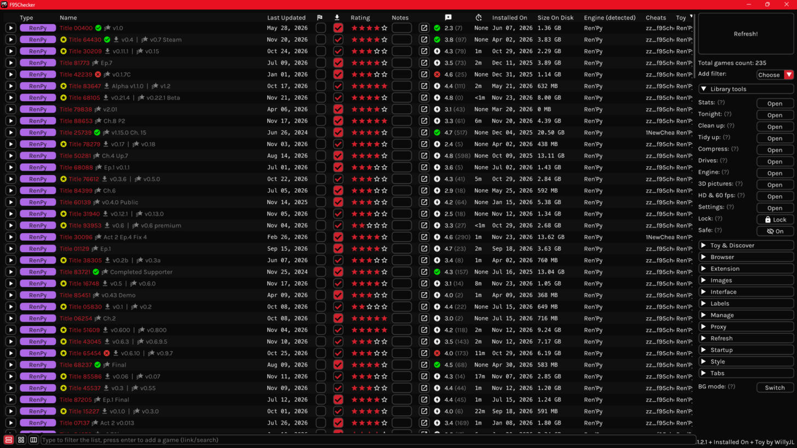

Un seul jeu tout de suite : clic droit → **Scan Local Copy**.

## 3. Library tools et réglages

Tous les nouveaux outils sont dans la section **Library tools** de la barre latérale (et **Toy & Discover**). Le **(?)** à
côté de chacun l'explique.

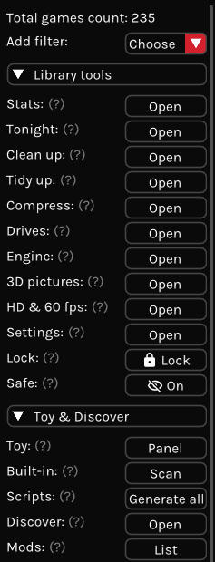

**Settings: Open** regroupe toutes les options :

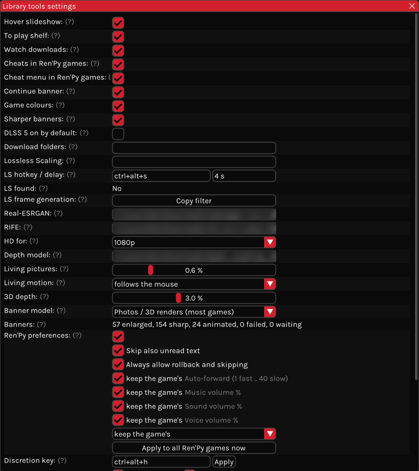
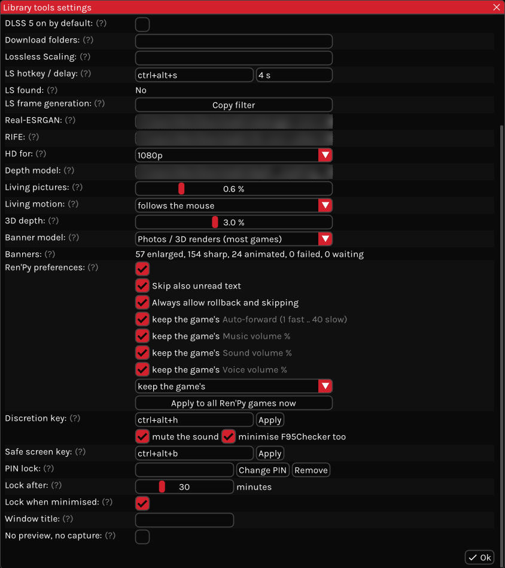

Chemins d'outils vides (Real-ESRGAN, RIFE, Depth model) = ceux fournis dans `tools`. Ne les remplis que pour utiliser une
autre copie.

## 4. Mises à jour

**Manage → Updates to do: Open** — les jeux dont ta copie est plus ancienne que la dernière version, les plus récemment
joués en premier.

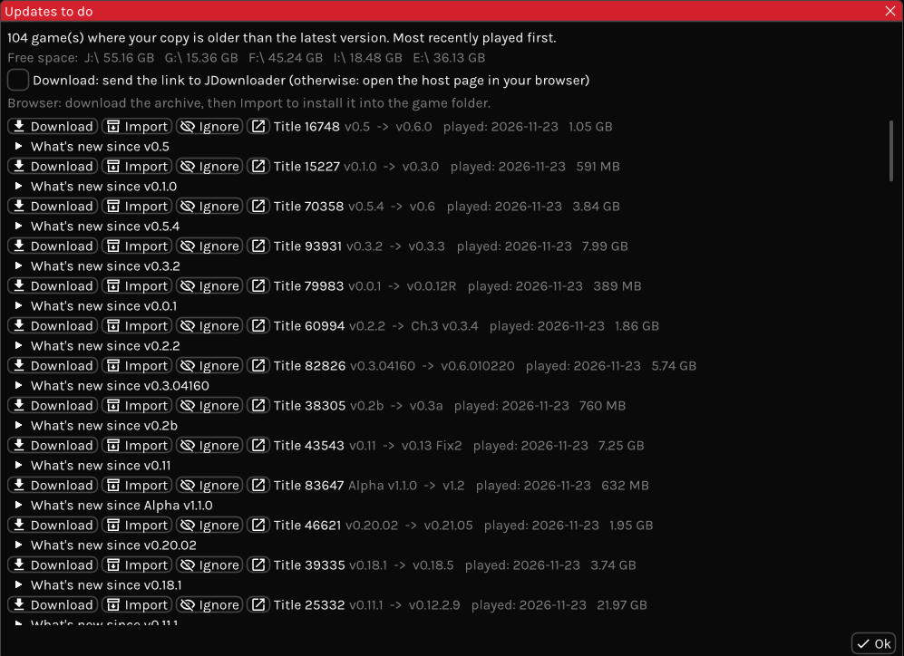

- **What's new since …** : le changelog coupé à ta version.
- **Download** : ouvre la page de l'hébergeur dans **ton navigateur** (ou envoie le lien à JDownloader si tu coches la
  case).
- **Import** : installe l'archive téléchargée (voir ci-dessous). **Ignore** : masque cette mise à jour jusqu'à la
  suivante.

**Import Update** (fiche du jeu, clic droit, ou *Import* ci-dessus) : choisis le `.zip` / `.7z` / `.rar` (le `.rar`
demande 7-Zip ou WinRAR installé). Un aperçu montre le dossier cible, les fichiers remplacés / ajoutés, la version, et
propose de renommer le dossier à la nouvelle version. **Install** extrait sur le même disque, vérifie que le jeu n'est pas
lancé, copie ses sauvegardes, remplace les fichiers, coche Installed et le date du jour. Les fichiers absents de l'archive
(tes mods, tes sauvegardes) sont gardés.

**Surveillance des téléchargements** (active par défaut, sur ton dossier Téléchargements) : quand une archive qui
ressemble à un de tes jeux finit de se télécharger, une fenêtre propose **Import into <jeu>**.

**Jeux finis** (Manage → *Finished games: Review*) : les jeux terminés dont tu as la dernière version et auxquels tu n'as
pas joué depuis 60 jours. Marque-les finis, et désinstalle-les si tu veux (sauvegardes copiées avant).

## 5. L'onglet Status

Fiche du jeu → onglet **Status** : tout ce que F95Checker Enhanced a ajouté ou trouvé pour ce jeu, une ligne par sujet,
avec son bouton (mise à jour, dossier, taille et compression, triche, galerie, menu de triche, HD & 60 fps, 3D, mods,
dernière erreur, jouet).

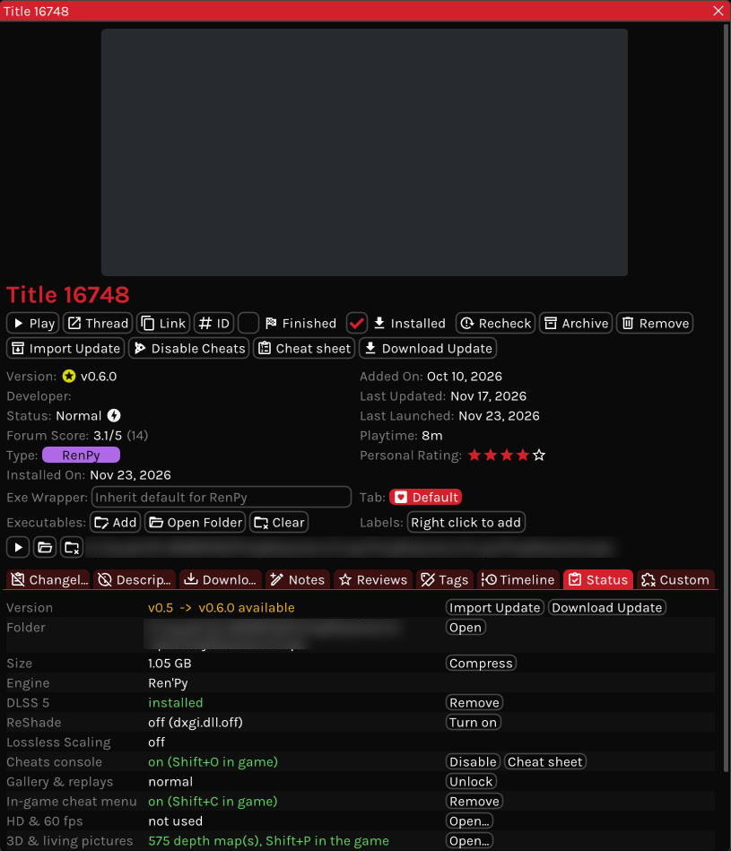

## 6. Outils Ren'Py

Ils n'ajoutent que de petits fichiers dans le dossier `game` du jeu, et se retirent tous.

- **Console** (active par défaut) : en jeu, **Maj+O** ouvre la console, **Maj+D** le menu développeur. Clic droit →
  *Disable Cheats* la retire de ce jeu, et elle reste retirée.
- **Fiche de triche** (clic droit → *Cheat sheet*) : les variables du jeu lues dans ses scripts (rien n'est exécuté),
  classées en Money, Relationships, Stats, Items, Flags. **Copy** sur une ligne, puis en jeu : **sauvegarde d'abord**,
  Maj+O, Ctrl+V, Entrée. *value on screen* + *Copy search by value* retrouve une variable à partir du nombre affiché
  par le jeu.

  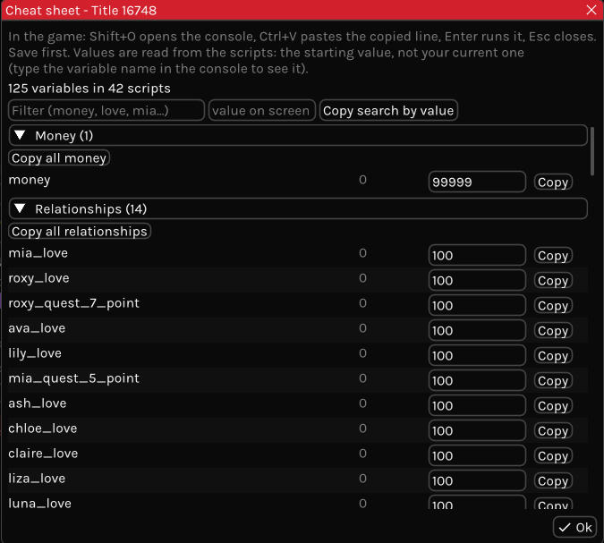
- **Menu de triche en jeu** (actif par défaut) : en jeu, **Maj+C** ouvre un menu avec des boutons -10 / -1 / +1 / +10 /
  MAX et des interrupteurs pour chaque variable. Réécrit après chaque mise à jour. Clic droit → *Remove in-game cheat
  menu* pour un jeu.
- **Unlock gallery & replays** (clic droit) : chaque image de la galerie et chaque replay compte comme « déjà vu ».
  *Lock* remet comme avant.
- **Préférences Ren'Py** (Settings) : passer aussi le texte non lu, **retour arrière et avance rapide toujours
  permis**, vitesse d'avance auto, volumes, mode fenêtre — appliqués une fois à chaque jeu Ren'Py (seulement là où le jeu
  est encore à sa valeur de départ).
- **What went wrong?** : s'ouvre tout seul quand un jeu lancé depuis F95Checker se ferme sur une erreur, ou clic droit →
  *What went wrong?*. Explique l'erreur et propose la correction quand il y en a une (fichiers moteur mélangés, mod
  cassé, script resté de la version précédente, fichiers manquants…).
- **Install a mod** (clic droit) : depuis l'archive ou le dossier extrait ; posé là où le mod l'attend, sauvegardes
  copiées, fichiers remplacés gardés. Clic droit → *Installed mods* → **Uninstall** remet tout comme avant.
- **Mods & extras** (Toy & Discover → *Mods: List*) : liens de mods / walkthrough / patchs trouvés dans les threads de
  tes jeux.

## 7. HD & 60 fps

Clic droit sur un jeu Ren'Py → **HD & 60 fps...** La fenêtre analyse le jeu et propose :

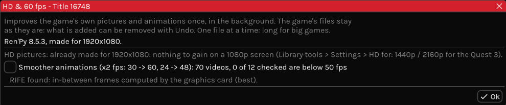

- **Images HD** : pour les jeux en **Ren'Py 8.4 ou plus** faits pour une définition plus petite que ton écran. Chaque
  image est agrandie par Real-ESRGAN et enregistrée à côté de l'originale en `nom@2.png` ; Ren'Py l'utilise tout seul en
  plein écran. Settings → **HD for** : 1080p (par défaut), 1440p ou 2160p (écran 4K, casque VR). Environ 3 à 4 fois la
  place des images du jeu.
- **Animations plus fluides** : les vidéos sous 50 i/s reçoivent leurs images intermédiaires, calculées par RIFE sur la
  carte graphique (30 → 60 i/s, 24 → 48 i/s), **même durée** (le timing du jeu ne change pas). Les vidéos avec son ou
  transparence restent telles quelles.

**Start**, puis laisse tourner en arrière-plan (tu peux fermer la fenêtre). **Undo** retire tout ce qui a été ajouté.

Toute la bibliothèque : **Library tools → HD & 60 fps: Open → Start all**. Un jeu après l'autre ; **Cancel** ou fermer
F95Checker l'arrête, Start all reprend là où il s'était arrêté. Un disque avec moins de 15 Go libres est laissé de côté.
**Skip this game** passe le jeu en cours (ce qui est fait est gardé) et continue avec le suivant ; le prochain Start all y revient.

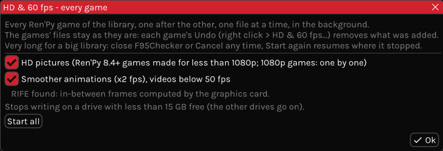

## 8. 3D & images vivantes

Pour les jeux **Ren'Py 8.1+**. Clic droit → **3D & living pictures... → Start** : chaque image et animation du jeu
reçoit une carte de profondeur, calculée une seule fois par ta carte graphique (la ligne de progression affiche
*DmlExecutionProvider* quand c'est la carte graphique qui calcule). Les fichiers du jeu et tes sauvegardes ne sont pas
touchés.

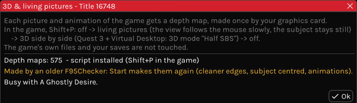

En jeu, **Maj+P** fait défiler :
- **Images vivantes** : la vue tourne doucement vers la souris ; le sujet reste immobile, le décor glisse derrière et ce
  qui est proche passe légèrement devant. Rien ne bouge si la souris ne bouge pas. Settings → *Living motion: slow sway*
  pour un mouvement automatique, *Living pictures* pour l'amplitude.
- **3D côte à côte** : une image par œil. Dans un casque VR (ex. Quest 3 + **Virtual Desktop**) : joue en plein écran,
  puis dans la barre de Virtual Desktop choisis le mode 3D **Half SBS**. Settings → *3D depth* règle l'intensité (3 %
  par défaut).
- **off**.

Toute la bibliothèque : **Library tools → 3D pictures: Open → Start all** (long : laisse tourner la nuit).
**Skip this game** passe le jeu en cours (cartes déjà faites gardées) ; le prochain Start all le reprend là où il en était.

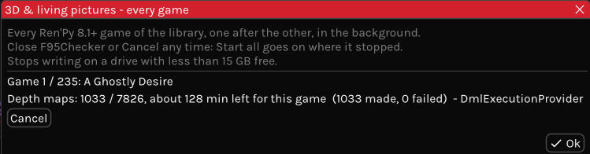

Option, modèle plus précis : télécharge toi-même *Depth Anything V2 Base*
(huggingface.co/onnx-community/depth-anything-v2-base → `onnx/model.onnx`) et enregistre-le sous
`depth_anything_v2_base.onnx` dans Téléchargements ; il remplace le Small (plus lent ; licence non commerciale, donc il
ne peut pas être fourni).

## 9. Bibliothèque

- **Diaporama au survol** : laisse la souris sur la carte d'un jeu, ses captures du thread défilent.
- Étagère **To play** : les jeux mis à jour depuis ta dernière partie (UPDATE) ou installés et jamais lancés (NEW).
- Bandeau **Continue** : le dernier jeu lancé, avec Play.
- **Bannières plus nettes** : les petites bannières agrandies par Real-ESRGAN (originales intactes).
- **What to play tonight?** (bouton au-dessus de la grille, ou *Tonight*) : un jeu tiré parmi tes jeux installés et pas
  finis, avec les raisons.

  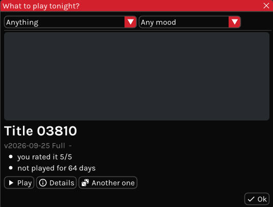
- **Statistiques** (*Stats*) : temps de jeu par semaine, développeurs et tags préférés, moteurs, place par disque.

  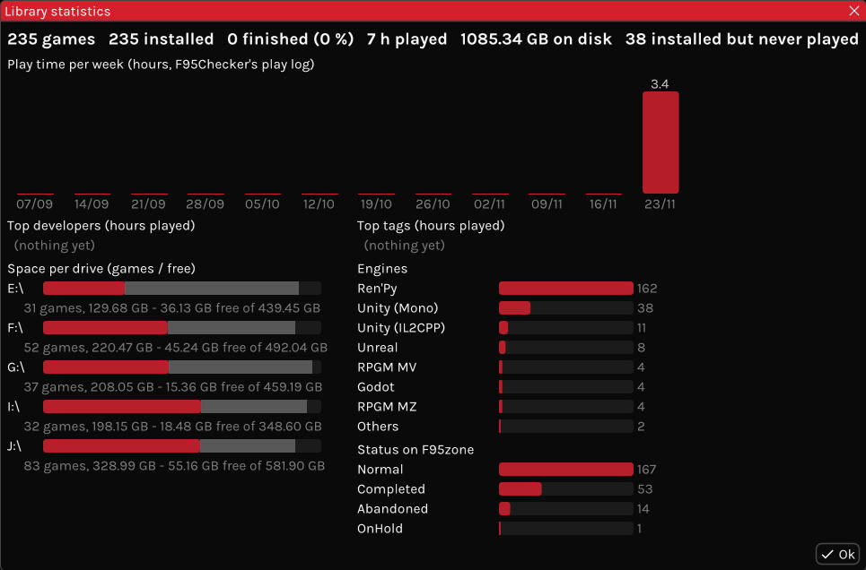
- **Recommandations** (Toy & Discover → *Discover*) : des jeux qui pourraient te plaire, d'après tes notes et ton temps
  de jeu.

## 10. Jouet connecté

Il faut **[Intiface Central](https://intiface.com/central)** (gratuit) : installe-le, *Settings → Start Server when
Intiface Central launches*, allume ton jouet, *Devices → Start Scanning*. Puis **Toy & Discover → Toy: Panel**.

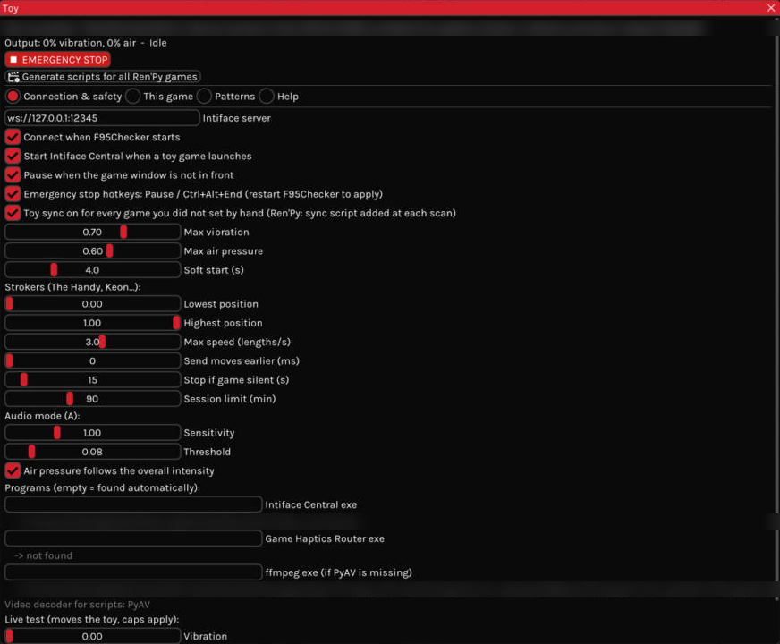

- **Jeux Ren'Py** : un petit script dit à F95Checker quelle animation est à l'écran ; le jouet suit un script généré à
  partir du mouvement de cette animation (une pulsation par va-et-vient). **Scripts: Generate all** prépare tous les
  jeux à l'avance (des heures, sur plusieurs cœurs) ; sinon chaque animation est analysée la première fois qu'elle
  s'affiche.
- **Unity / Unreal** : les vibrations de manette, via Intiface Game Haptics Router. **Autres jeux** : suit le son.
- **Va-et-vient** (The Handy, Keon…) : suivent les positions du script.
- **Sécurité** : plafonds de puissance, démarrage doux, pause quand le jeu n'est pas au premier plan, durée maximale,
  arrêt quand le jeu se ferme. **Arrêt d'urgence : touche Pause ou Ctrl+Alt+Fin**, partout dans Windows, ou le bouton
  rouge STOP TOY.
- Par jeu : clic droit → *Toy* (synchro oui / non, mode, intensité, décalage).

## 11. Disques et ménage

- **Compress** : la compression intégrée à Windows (comme CompactGUI). Gain estimé par jeu, *Compress selected*, *Undo*.
  Gros gain sur Unity / Unreal / RPG Maker, faible sur Ren'Py. Disques NTFS uniquement.

  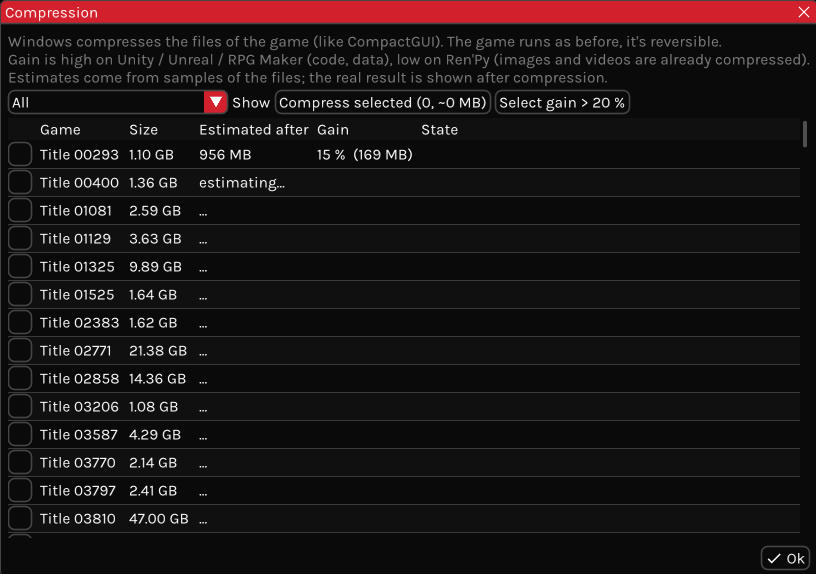
- **Drives** : déplace les jeux joués il y a le plus longtemps d'un disque plein vers un disque plus vide, copie vérifiée
  avant de supprimer l'ancien dossier.
- **Clean up** : archives déjà installées, caches Ren'Py, restes d'imports interrompus.
- **Tidy up** : range les jeux posés à la racine d'une bibliothèque dans tes dossiers de catégorie, appris de ton
  rangement.
- **Engine** : les fichiers moteur Ren'Py identiques stockés une seule fois par disque (liens physiques NTFS). *Undo*
  les sépare de nouveau.

## 12. Discrétion

- **Touche de discrétion** (Ctrl+Alt+H par défaut) : arrête le jouet, réduit les jeux et F95Checker, coupe le son. Encore
  une fois : tout revient (le jouet reste arrêté).
- **Écran sage** (Ctrl+Alt+B ou *Safe* dans la barre latérale) : bannières, noms, tags, notes et captures masqués dans
  l'interface, F95Checker reste utilisable.
- **Verrou par code** (Settings) : demandé au démarrage, après X minutes d'inactivité, quand F95Checker est réduit. En
  option : titre de fenêtre neutre et « pas d'aperçu, pas de capture ». Code oublié : ferme F95Checker, ouvre
  `%APPDATA%\f95checker\local_scan_prefs.json` et vide `"lock_hash"`.

## 13. Profil d'affichage

Clic droit → **Display profile** :
- **Lossless Scaling** (payant, Steam) : *scaling* ou *frame generation* lancé avec le jeu.
- **ReShade** : activé / désactivé au lancement pour les jeux où tu l'as installé.
- **Kit DLSS 5** (avancé) : seulement si tu as préparé ton propre dossier de kit ; rien n'est fourni. Désactivé par
  défaut.

## 14. Annuler, problèmes, signaler un bug

- Chaque ajout a son *Remove / Undo / Lock / Uninstall* (clic droit ou onglet Status). Décoche une option dans Settings
  pour l'arrêter sur tous les jeux au prochain Refresh.
- Un jeu ne démarre plus après un ajout → clic droit → **What went wrong?**, ou retire le dernier ajout.
- Erreurs *Real-ESRGAN / RIFE / Vulkan* : mets à jour le pilote de ta carte graphique.
- Revenir au F95Checker officiel : lance-le simplement ; tes données sont compatibles.
- **Bugs** : ouvre une *issue* sur https://github.com/Alex200295/F95Checker_Enhanced/issues avec ce que tu as fait, ce qui
  s'est passé, et le `traceback.txt` du jeu si c'est une erreur de jeu. Pas chez WillyJL.
