# F95Checker Enhanced — User guide

**[Français](GUIDE_UTILISATEUR.md)** · [README](../README.md) · [Patch notes](../CHANGELOG.md)

The screenshots are taken with the **Safe screen** on (Ctrl+Alt+B): banners are grey tiles and game names are replaced
by "Title 01234". In your copy you will see your real games.

Contents:
[1. Install](#1-install) ·
[2. First scan](#2-first-scan-and-the-new-columns) ·
[3. Library tools](#3-library-tools-and-settings) ·
[4. Updates](#4-updates) ·
[5. Status tab](#5-the-status-tab) ·
[6. Ren'Py tools](#6-renpy-tools) ·
[7. HD & 60 fps](#7-hd--60-fps) ·
[8. 3D & living pictures](#8-3d--living-pictures) ·
[9. Library extras](#9-library-extras) ·
[10. Connected toy](#10-connected-toy) ·
[11. Disks](#11-disks-and-housekeeping) ·
[12. Privacy](#12-privacy) ·
[13. Display profile](#13-display-profile) ·
[14. Undo, problems, bugs](#14-undo-problems-bug-reports)

---

## 1. Install

1. Download `F95Checker_Enhanced-Windows.zip` from the
   [latest release](https://github.com/Alex200295/F95Checker_Enhanced/releases/latest).
2. Unzip it into **its own empty folder** (e.g. `C:\Programs\F95Checker Enhanced`). Not in `%APPDATA%\f95checker`.
3. Run `F95Checker.exe`. Windows SmartScreen may warn about an unknown publisher: *More info → Run anyway*.
4. New to F95Checker: log in to F95zone when asked, then add your games (paste a thread link in the bottom bar, or
   *Manage → Import*). Coming from F95Checker: your library is already there.

The `tools` folder next to the exe holds Real-ESRGAN, RIFE, ffmpeg and the depth model. Leave it there. Updates are
offered by the app itself (*Update available* popup) and replace the whole folder.

## 2. First scan and the new columns

The **local scan** runs by itself at the end of every full **Refresh**. For the first time:

1. Wait until no Refresh is running.
2. Sidebar → **Manage** → **Local scan: Scan** → **Yes**. The confirmation lists the library folders found (deduced from
   your games' executables, plus *Set exe dir*): check that all your game drives are there.
3. When it's done, a window sums up what changed; **Details** lists it game by game.

For each game the scan:
- keeps the executable if it's valid, finds it again if you moved or renamed the folder, or finds it by name / acronym;
- switches to a **newer folder of the same game** if there is one;
- ticks **Installed** when your copy is the latest version (version in the folder name, or file dates), unticks it when
  your copy is older;
- reads the **Installed On** date (when your version's files arrived on the disk; playing doesn't change it), the size,
  the real engine, the cheat mods present, and the last time you played (from the saves and logs);
- lists **old versions and duplicate copies** with a **Delete old versions** button (recycle bin or permanent; saves are
  copied to `%APPDATA%\f95checker\saves_backup` first; a folder holding a game's executable is never deleted).

List view (first icon bottom left) → right click on a column header to show the new columns: **Installed On**,
**Size On Disk**, **Engine (detected)**, **Cheats**, **Toy**. Click a header to sort.

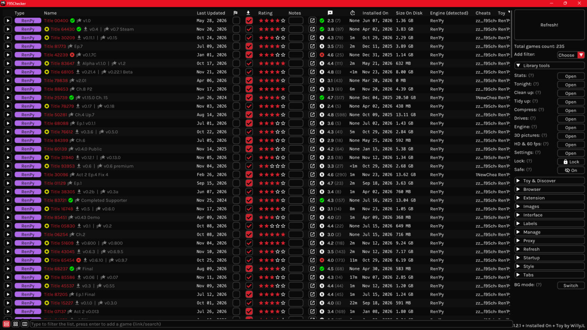

One game right now: right click → **Scan Local Copy**.

## 3. Library tools and settings

Every new tool is in the sidebar section **Library tools** (and **Toy & Discover**). The **(?)** next to each one
explains it.

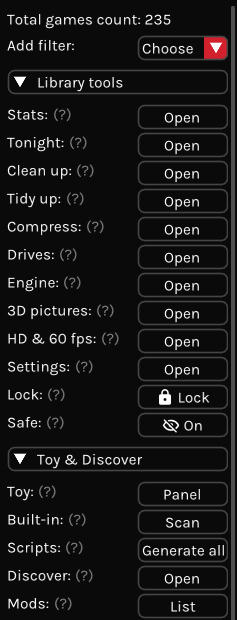

**Settings: Open** gathers all the options:

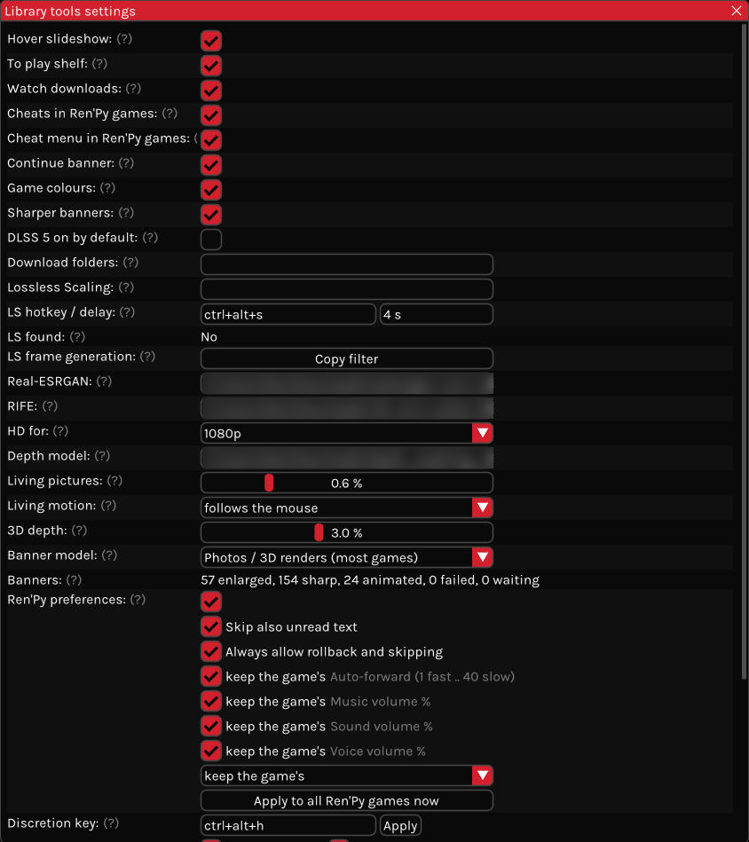
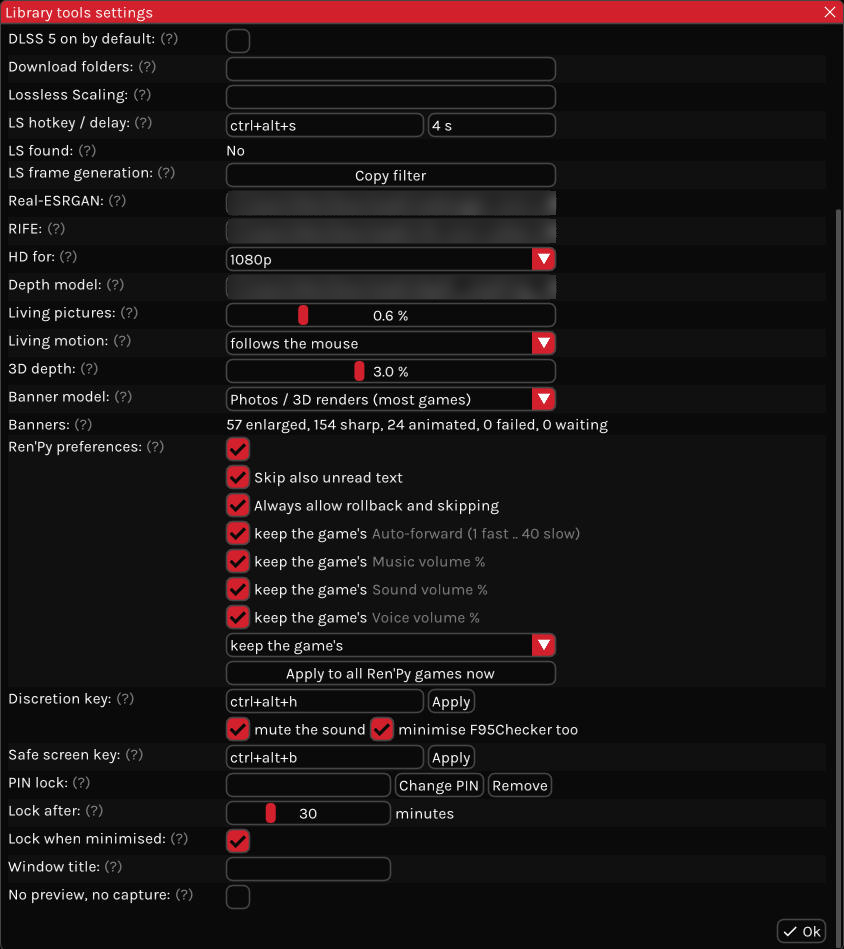

Empty tool paths (Real-ESRGAN, RIFE, Depth model) = the ones shipped in `tools`. Fill them only to use another copy.

## 4. Updates

**Manage → Updates to do: Open** — the games where your copy is older than the latest version, most recently played
first.

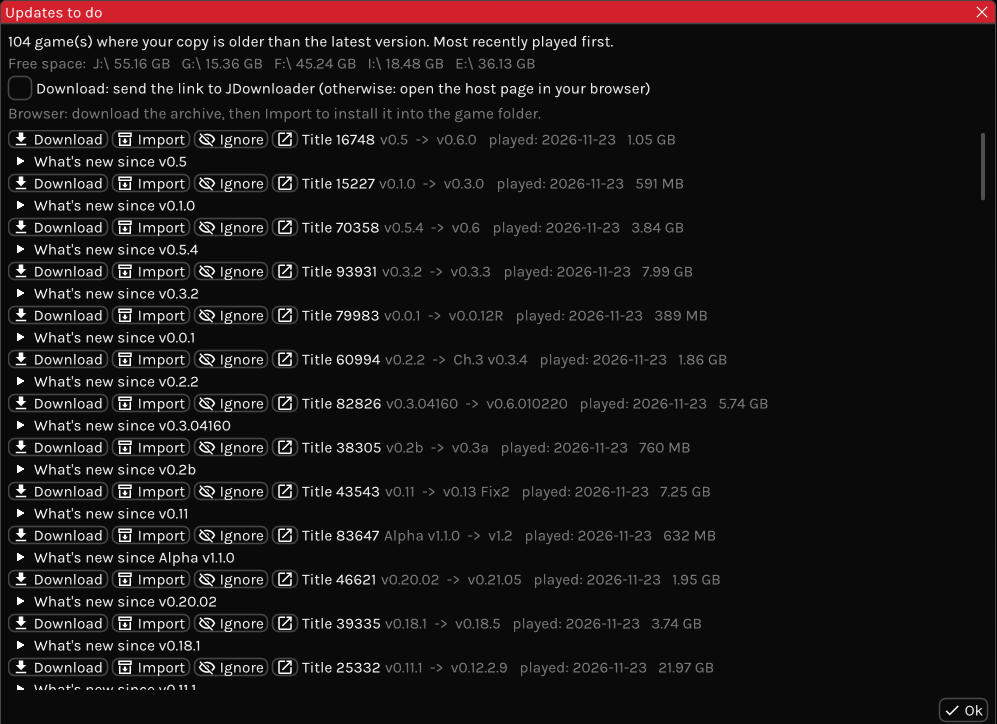

- **What's new since …**: the changelog cut at your version.
- **Download**: opens the download host page in **your browser** (or sends the link to JDownloader if you tick the box).
- **Import**: installs the downloaded archive (see below). **Ignore**: hides this update until the next one.

**Import Update** (game info, right click, or *Import* above): choose the `.zip` / `.7z` / `.rar` (`.rar` needs 7-Zip or
WinRAR installed). A preview shows the target folder, the files replaced / added, the version, and offers to rename the
folder to the new version. **Install** extracts on the same drive, checks that the game isn't running, copies its saves,
replaces the files, ticks Installed and dates it today. Files missing from the archive (your mods, saves) are kept.

**Downloads watcher** (on by default, watches your Downloads folder): when an archive that looks like one of your games
finishes downloading, a window offers **Import into <game>**.

**Finished games** (Manage → *Finished games: Review*): completed games you have the last version of and haven't played
for 60 days. Mark them finished, and optionally uninstall them (saves backed up first).

## 5. The Status tab

Game info → **Status** tab: everything F95Checker Enhanced added or found for this game, one line per subject, with its
button (update, folder, size and compression, cheats, gallery, cheat menu, HD & 60 fps, 3D, mods, last error, toy).

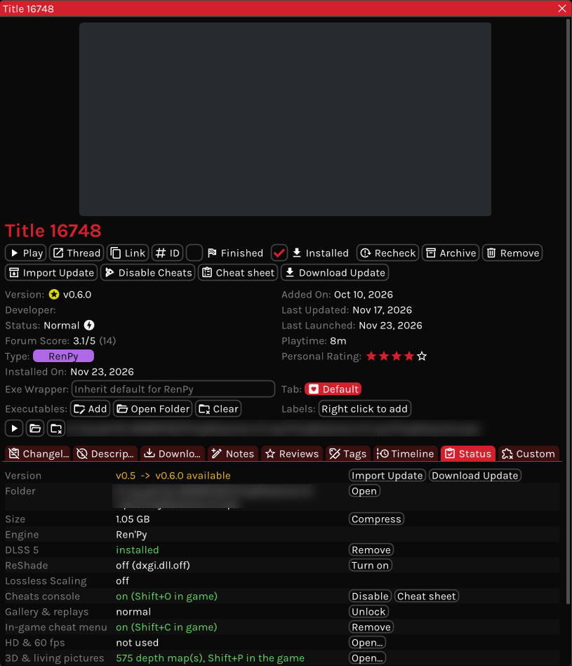

## 6. Ren'Py tools

All of them only add small files to the game's `game` folder and can be removed.

- **Console** (on by default): in the game, **Shift+O** opens the console, **Shift+D** the developer menu. Right click →
  *Disable Cheats* removes it from this game and keeps it removed.
- **Cheat sheet** (right click → *Cheat sheet*): the game's variables read from its scripts (nothing is run), sorted by
  Money, Relationships, Stats, Items, Flags. **Copy** a line, then in the game: **save first**, Shift+O, Ctrl+V, Enter.
  *value on screen* + *Copy search by value* finds a variable from the number the game shows.

  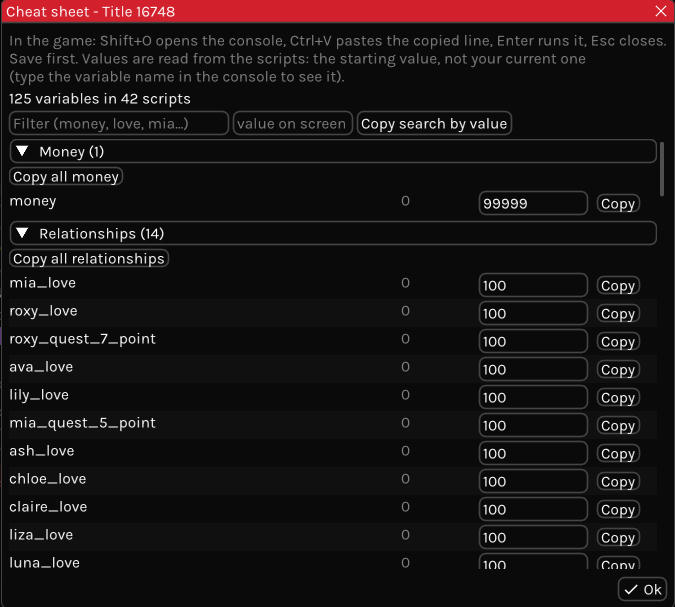
- **In-game cheat menu** (on by default): in the game, **Shift+C** opens a menu with -10 / -1 / +1 / +10 / MAX buttons and
  switches for every variable. Rewritten after each update. Right click → *Remove in-game cheat menu* for one game.
- **Unlock gallery & replays** (right click): every gallery picture and replay is "already seen". *Lock* puts it back.
- **Ren'Py preferences** (Settings): skip unread text, **always allow rollback and skipping**, auto-forward speed,
  volumes, window mode — applied once to every Ren'Py game (only where the game is still at its default).
- **What went wrong?**: opens by itself when a game launched from F95Checker closes on an error, or right click → *What
  went wrong?*. It explains the error and offers the fix when there is one (mixed engine files, broken mod, a script left
  from the previous version, missing files…).
- **Install a mod** (right click): from the archive or the extracted folder; placed where the mod expects it, saves
  backed up, replaced files kept. Right click → *Installed mods* → **Uninstall** puts everything back.
- **Mods & extras** (Toy & Discover → *Mods: List*): mod / walkthrough / patch links found in your games' threads.

## 7. HD & 60 fps

Right click on a Ren'Py game → **HD & 60 fps...** The window analyses the game and offers:

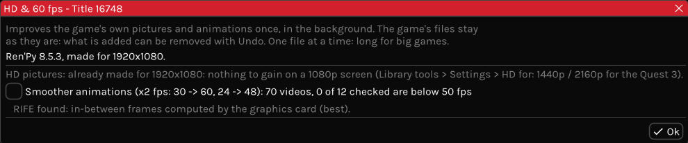

- **HD pictures**: for games on **Ren'Py 8.4 or newer** made for a smaller resolution than your screen. Every picture is
  enlarged by Real-ESRGAN and saved next to the original as `name@2.png`; Ren'Py uses it by itself in full screen.
  Settings → **HD for**: 1080p (default), 1440p or 2160p (4K screen, VR headset). About 3 to 4 times the space of the
  game's pictures.
- **Smoother animations**: videos under 50 fps get their in-between frames computed by RIFE on the graphics card
  (30 → 60 fps, 24 → 48 fps), **same length** (the game's timing doesn't change). Videos with sound or transparency are
  left as they are.

**Start**, then let it work in the background (you can close the window). **Undo** removes everything that was added.

Whole library: **Library tools → HD & 60 fps: Open → Start all**. One game after the other; **Cancel** or closing
F95Checker stops it, Start all resumes where it stopped. A drive with less than 15 GB free is left alone.
**Skip this game** leaves the current game (what is made is kept) and goes on with the next one; the next Start all comes back to it.

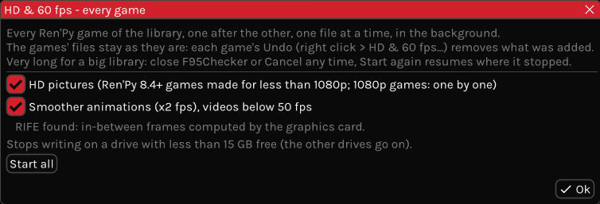

## 8. 3D & living pictures

For **Ren'Py 8.1+** games. Right click → **3D & living pictures... → Start**: every picture and animation of the game gets
a depth map, computed once by your graphics card (the progress line shows *DmlExecutionProvider* when the graphics card
is used). The game's files and saves are not touched.

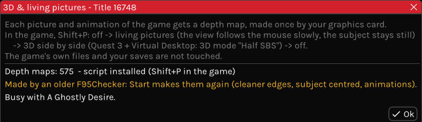

In the game, **Shift+P** cycles:
- **Living pictures**: the view turns gently towards the mouse; the subject stays still, the background slides behind and
  near things pass slightly in front. Nothing moves if the mouse doesn't. Settings → *Living motion: slow sway* for an
  automatic movement, *Living pictures* for the amount.
- **3D side by side**: one picture per eye. In a VR headset (e.g. Quest 3 + **Virtual Desktop**): play full screen, then
  in Virtual Desktop's bar choose the 3D mode **Half SBS**. Settings → *3D depth* sets the strength (3 % default).
- **off**.

Whole library: **Library tools → 3D pictures: Open → Start all** (long: let it run at night).
**Skip this game** leaves the current game (the depth maps made are kept); the next Start all resumes it where it was.

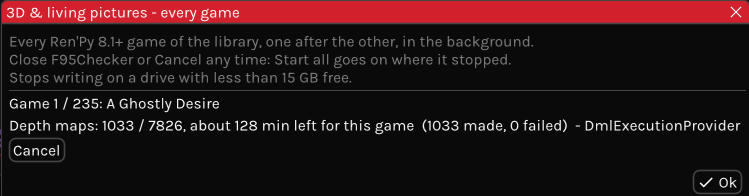

Optional, more precise model: download *Depth Anything V2 Base* yourself
(huggingface.co/onnx-community/depth-anything-v2-base → `onnx/model.onnx`), save it as `depth_anything_v2_base.onnx` in
your Downloads folder; it is used instead of the Small one (slower; non-commercial license, so it can't be shipped).

## 9. Library extras

- **Hover slideshow**: leave the mouse on a game card, its thread screenshots play.
- **To play** shelf: games updated since you last played (UPDATE) or installed and never launched (NEW).
- **Continue** banner: the last game you played, with Play.
- **Sharper banners**: small banners enlarged by Real-ESRGAN (originals untouched).
- **What to play tonight?** (button above the grid, or *Tonight*): a game picked from your installed, unfinished games,
  with the reasons.

  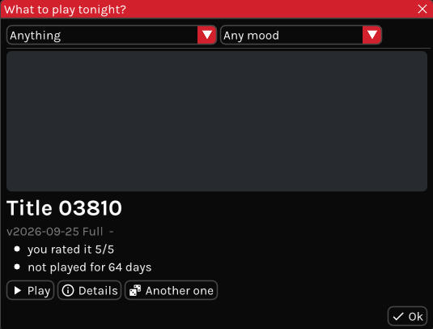
- **Statistics** (*Stats*): play time per week, top developers and tags, engines, space per drive.

  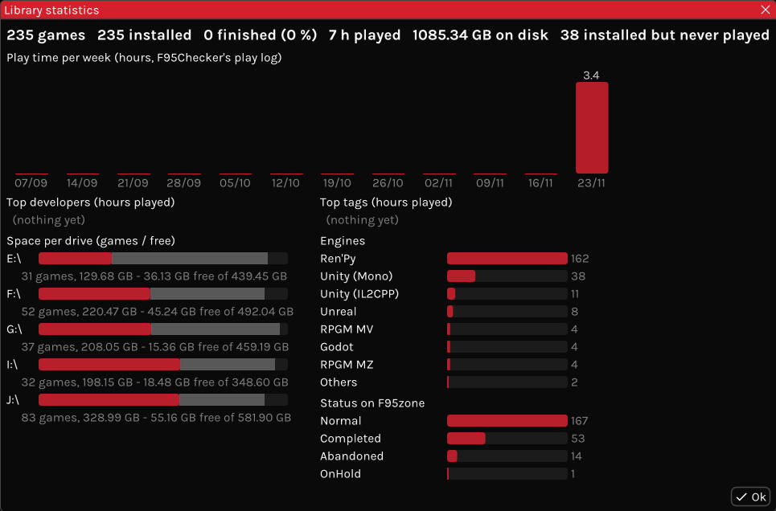
- **Recommendations** (Toy & Discover → *Discover*): games you may like, from your ratings and play time.

## 10. Connected toy

Needs **[Intiface Central](https://intiface.com/central)** (free): install it, *Settings → Start Server when Intiface
Central launches*, turn your toy on, *Devices → Start Scanning*. Then **Toy & Discover → Toy: Panel**.

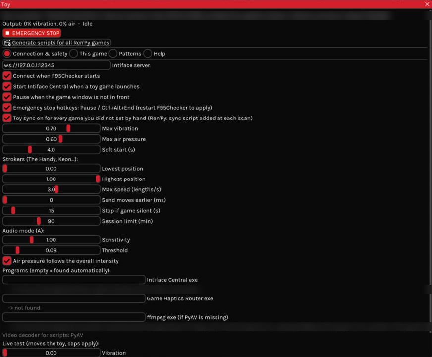

- **Ren'Py games**: a small script tells F95Checker which animation is on screen; the toy follows a script generated from
  that animation's motion (one pulse per stroke). **Scripts: Generate all** prepares every game in advance (hours, uses
  several CPU cores); otherwise each animation is analysed the first time it's shown.
- **Unity / Unreal**: controller rumble through Intiface Game Haptics Router. **Other games**: follows the sound.
- **Strokers** (The Handy, Keon…) follow the script positions.
- **The Handy over WiFi** (no Intiface): Handy on your WiFi (pink LED), its connection key (Handy app) in the panel → *Connect*.
  It plays each animation's script by itself, in step with the game. An Application ID for the Handy API is asked once
  (free, Handy developer portal). Use WiFi or Bluetooth, not both.
- **Safety**: caps on strength, soft start, pause when the game isn't in front, session limit, stop when the game quits.
  **Emergency stop: Pause key or Ctrl+Alt+End**, anywhere in Windows, or the red STOP TOY button.
- Per game: right click → *Toy* (sync on / off, mode, intensity, offset).

## 11. Disks and housekeeping

- **Compress**: Windows' built-in compression (like CompactGUI). Estimated gain per game, *Compress selected*, *Undo*.
  Big gains on Unity / Unreal / RPG Maker, small on Ren'Py. NTFS drives only.

  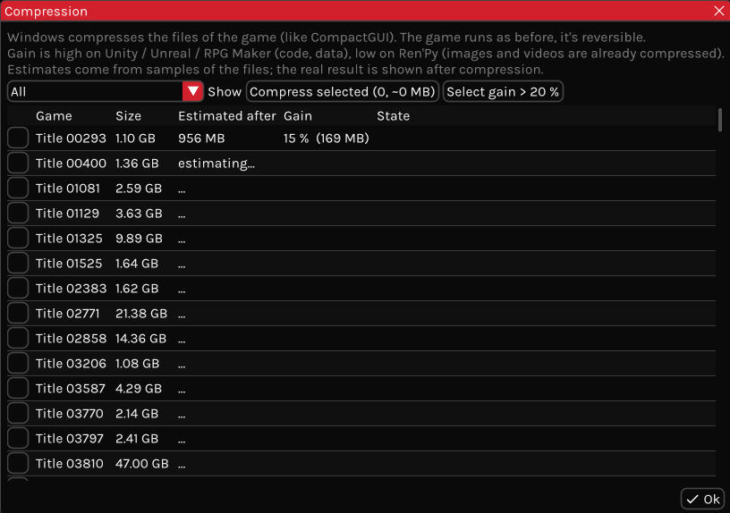
- **Drives**: moves the least recently played games from a full drive to an emptier one, copy verified before the old
  folder is deleted.
- **Clean up**: archives already installed, Ren'Py caches, leftovers of interrupted imports.
- **Tidy up**: puts games left at the root of a library into your category folders, learnt from how you sort them.
- **Engine**: identical Ren'Py engine files stored once per drive (NTFS hard links). *Undo* splits them again.

## 12. Privacy

- **Discretion key** (Ctrl+Alt+H by default): stops the toy, minimises the games and F95Checker, mutes the sound. Again:
  everything comes back (the toy stays stopped).
- **Safe screen** (Ctrl+Alt+B or *Safe* in the sidebar): banners, names, tags, notes and screenshots hidden in the
  interface, F95Checker stays usable.
- **PIN lock** (Settings): asked at startup, after X minutes idle, when minimised. Optional neutral window title and
  "no preview, no capture". Forgotten PIN: close F95Checker, open `%APPDATA%\f95checker\local_scan_prefs.json` and empty
  `"lock_hash"`.

## 13. Display profile

Right click → **Display profile**:
- **Lossless Scaling** (paid, Steam): *scaling* or *frame generation* started with the game.
- **ReShade**: on / off at launch for games where you installed it.
- **DLSS 5 kit** (advanced): only if you built your own kit folder; nothing is shipped. Off by default.

## 14. Undo, problems, bug reports

- Every addition has its *Remove / Undo / Lock / Uninstall* (right click or Status tab). Untick an option in Settings to
  stop it for every game at the next Refresh.
- A game won't start after an addition → right click → **What went wrong?**, or remove the last thing you added.
- *Real-ESRGAN / RIFE / Vulkan errors*: update your graphics driver.
- Back to the official F95Checker: just run it; your data is compatible.
- **Bugs**: open an issue on https://github.com/Alex200295/F95Checker_Enhanced/issues with what you did, what happened,
  and the game's `traceback.txt` if it's a game error. Not to WillyJL.
